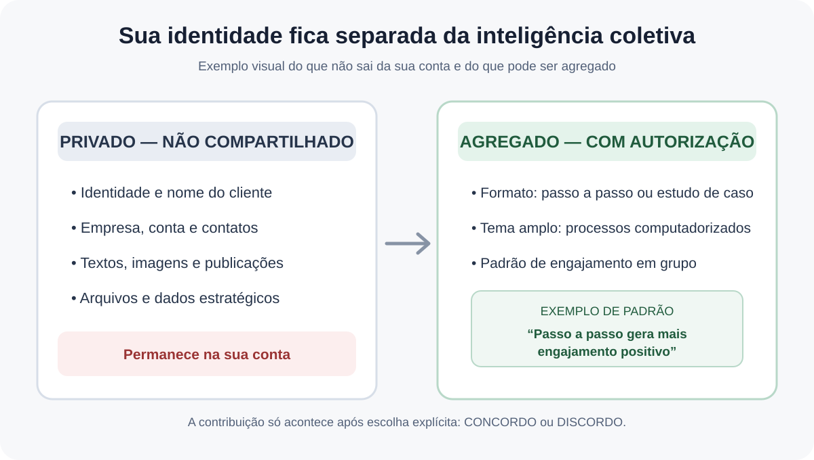

# Decisões de produto — inteligência coletiva de métricas e armazenamento local de publicações

Status: decisões aprovadas pelo responsável do produto em 08/11/2026.  
Escopo: contrato funcional e de privacidade; ainda não representa implementação de interface, sincronização ou banco.

## 1. Consentimento para inteligência coletiva de métricas

### 1.1 Princípio obrigatório — explicar antes de pedir consentimento

A tela deve começar deixando explícito, em linguagem simples e destacada:

- A identidade do cliente permanece isolada dos dados analíticos gerais.
- Não são compartilhados nome, e-mail, empresa, perfil, conta, publicações originais, textos, imagens, arquivos, contatos, público, métricas individuais identificáveis ou qualquer dado pessoal/estratégico que revele o cliente.
- A integridade intelectual e a privacidade do cliente devem ser preservadas.
- Somente estruturas e padrões de análise, previamente desidentificados e agregados, poderão alimentar a base coletiva, se o cliente autorizar.
- A participação é opcional. A opção “Discordo” não pode reduzir funcionalidades essenciais nem gerar penalidade.
- O consentimento deve ser registrado por usuário, versão do texto, data/hora e estado; deve ser possível alterar ou revogar a escolha depois.
- Nenhum dado pode ser incluído na base coletiva antes de consentimento afirmativo.

Não prometer anonimato absoluto sem validação técnica. O sistema deve aplicar minimização, remoção de identificadores, limiares mínimos de agregação e revisão contra reidentificação antes de disponibilizar qualquer padrão.

### 1.2 Exemplo visual obrigatório\n\n\n\n### 1.3 O que são “métricas” neste contexto

Explicar que métricas compartilháveis são conclusões estruturais sobre formatos, características e desempenho agregado de conteúdo — não os conteúdos dos clientes.

Exemplos de estruturas analíticas:
- formato: passo a passo, estudo de caso, lista, opinião ou tutorial;
- tema em categoria ampla: processos computadorizados, logística, gestão etc.;
- característica editorial: presença de etapas, demonstração de processo, tipo de abordagem;
- sinal agregado de resultado: maior/menor engajamento positivo, dentro de uma amostra mínima;
- tendência temporal: um padrão que funcionou em certo período pode perder eficácia depois.

Exemplo didático obrigatório na tela:

“Posts em formato de passo a passo sobre processos computadorizados geram mais engajamento positivo do que posts em formato de estudo de caso sobre processos computadorizados.”

Exemplo de resultado agregado, sempre identificado como ilustrativo até que exista evidência real:

“Em uma pesquisa com 5 clientes, foi observado aumento de 30% nos posts produzidos dentro desses parâmetros.”

Não apresentar o exemplo como resultado real do produto, nem como causalidade comprovada, sem estudo efetivamente realizado, metodologia, período, amostra e validação. Na interface, usar rótulo como “Exemplo ilustrativo” enquanto não houver estudo verificável.

### 1.4 Por que compartilhar

A base coletiva ajuda a atualizar recomendações sem exigir que cada cliente repita todos os testes. Preferências e tendências mudam: uma cor que chama atenção hoje pode se tornar repetitiva amanhã. Resultados agregados e autorizados permitem que a inteligência evolua para todos os participantes sem expor quem contribuiu.

A base deve permanecer atualizada por novas observações elegíveis, com data, tamanho de amostra, período, confiança/limitações e expiração ou reavaliação de padrões antigos. Não tratar um padrão histórico como regra permanente.

### 1.5 Escolha explícita

Apresentar duas opções equivalentes e não pré-selecionadas:

- **Concordo:** autorizo o uso de estruturas analíticas desidentificadas e agregadas das minhas experiências para contribuir com a inteligência coletiva de métricas.
- **Discordo:** não autorizo que minhas experiências alimentem a base coletiva; minhas análises permanecem exclusivas da minha conta.

A escolha deve ser individual, granular para este propósito e revogável. “Discordo” não impede o cliente de receber recomendações derivadas da base coletiva, desde que não haja uso de seus próprios dados para alimentá-la.

### 1.6 Fluxo técnico e governança

- Separar fisicamente/logicamente identidade e dataset analítico.
- Manter a tabela de consentimento vinculada ao usuário em domínio de identidade; a camada analítica recebe somente registros elegíveis, sem identificador reversível do cliente.
- Não usar hash simples de e-mail, user_id ou account_id como pseudônimo compartilhável.
- Aplicar agregação mínima (limiar inicial a definir na implementação; o exemplo com cinco clientes não estabelece sozinho um limiar seguro).
- Suprimir grupos raros, combinações únicas e segmentos que possam revelar cliente.
- Revisar texto, imagem, metadados e payloads antes da ingestão.
- Registrar proveniência, versão da regra de anonimização, janela temporal e qualidade da evidência.
- Permitir exclusão futura de contribuições quando tecnicamente possível e definir previamente o efeito de revogação sobre dados já agregados.
- Não treinar modelos ou reutilizar conteúdo bruto com base neste consentimento; o escopo aprovado é somente estrutura analítica desidentificada/agregada.
- Consentimento não autoriza compartilhar dados brutos com outros clientes.

## 2. Publicações não aprovadas e armazenamento local

Decisão aprovada: publicações que ainda não foram aprovadas e/ou aguardam sua data de postagem devem permanecer no armazenamento interno/local do aparelho do próprio cliente.

Requisitos:
- O rascunho e seus dados associados ficam no espaço local do aparelho e sob controle do cliente.
- Não enviar automaticamente conteúdo não aprovado para uma fila compartilhada ou para armazenamento central como condição para mantê-lo.
- A interface deve distinguir claramente “salvo neste aparelho” de “sincronizado/armazenado na nuvem”, caso sincronização futura seja oferecida.
- Se houver backup/sincronização em nuvem no futuro, deve ser uma opção separada, explicada e consentida; nunca presumida a partir do consentimento de métricas.
- Publicação só pode entrar no fluxo de agendamento/publicação após aprovação explícita do cliente.
- A data programada, por si só, não equivale a aprovação.
- Definir UX de recuperação, exportação e perda/troca de aparelho antes de implementar armazenamento local como única cópia.
- Avaliar criptografia local, isolamento por perfil do sistema operacional, limites de armazenamento e comportamento offline.
- Não confundir armazenamento local de rascunhos com a fila cloud de publicações aprovadas, que continua sujeita ao contrato de agendamento separado.

## 3. Separação entre as duas autorizações

O consentimento para inteligência coletiva de métricas não concede autorização para sincronizar publicações, armazenar conteúdo na nuvem, conectar contas externas ou publicar conteúdo.

A aprovação de uma publicação não concede consentimento para compartilhar métricas. São decisões independentes.

## 4. Critérios de aceite da interface

- [ ] Explicação de privacidade e isolamento aparece antes dos botões de consentimento.
- [ ] A tela explica explicitamente o que entra e o que não entra na base geral.
- [ ] Inclui exemplo visual de “conteúdo privado” versus “padrão analítico agregado”.
- [ ] Inclui os exemplos textuais descritos nesta decisão.
- [ ] Resultados hipotéticos são marcados como ilustrativos; não inventar evidência.
- [ ] Botões “Concordo” e “Discordo” têm destaque equivalente e nenhum estado pré-selecionado.
- [ ] Cliente consegue rever e revogar a escolha.
- [ ] Preferência de métricas é independente de backup/sincronização e aprovação editorial.
- [ ] Rascunhos não aprovados permanecem locais e a interface informa isso claramente.
